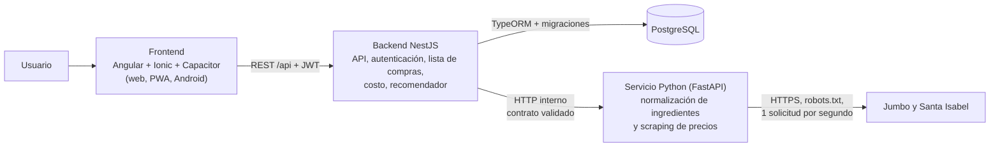

# MenuSmart

Planificador de comidas y comparador de precios de supermercado, para estudiantes, parejas o familias que quieren organizar mejor su alimentación y su presupuesto. Arma la lista de compras de la semana, estima cuánto cuesta en Jumbo y en Santa Isabel, y sugiere recetas baratas que reutilizan los ingredientes que ya planificaste.

Proyecto de la asignatura **Ingeniería Web Avanzada**.

**Stack:** Angular + Ionic + Capacitor · NestJS · Python + FastAPI · PostgreSQL · Docker · GitHub Actions · Terraform

## Enlaces

| Recurso | Enlace |
|---|---|
| Repositorio | https://github.com/JanHH16/MenuSmart |
| Entrega Parcial 1 (tag) | `v1.0.0-ep1` |
| Tag de la Entrega Parcial 2 y de la Entrega Final | `v1.1.0-ep2` (EP2) y `v2.0.0-ef` (Entrega Final), creados el 22-11-2026 sobre `main` |
| Ambiente de staging | Sitio: https://menusmart-staging-frontend.onrender.com · API: https://menusmart-staging-backend.onrender.com (plan gratuito de Render: si estaba dormido, la primera visita tarda cerca de 1 minuto; ver [Limitaciones](#limitaciones-conocidas)) |
| Tablero de gestión del proyecto | Pendiente: completar |
| Prototipo Figma | [Ver abajo](#prototipo-figma) |
| Documentación de la API (Swagger) | https://menusmart-staging-backend.onrender.com/api/docs, o `http://localhost:3000/api/docs` con el backend corriendo; especificaciones en [`docs/api/`](docs/api/README.md) |

## Integrantes y responsabilidades

| Integrante | Ámbitos principales |
|---|---|
| Jan Houter. ([@JanHH16](https://github.com/JanHH16)) | Backend (NestJS), persistencia de datos (PostgreSQL/TypeORM), recuperación de información web (servicio Python/FastAPI, scraping), DevOps e infraestructura (GitHub Actions, Docker, Terraform), documentación técnica |
| Camila Torres. [@camitwrs](https://github.com/camitwrs) | Frontend (Angular/Ionic), experiencia de usuario (arquitectura de layout adaptativo mobile/desktop, prototipo Figma), capacidad adaptativa o inteligente (diseño de la interacción y presentación al usuario), pruebas (cobertura del frontend), seguridad y calidad de código (revisión) |

## Problema y usuarios objetivo

Planificar comidas y hacer las compras de supermercado consume tiempo y suele hacerse de forma desordenada: sin una lista clara, repitiendo ingredientes que se usan una sola vez, o sin comparar precios entre supermercados por falta de tiempo o de información centralizada. Eso genera sobregasto y desperdicio de comida.

MenuSmart está pensado para estudiantes, parejas o familias que cocinan regularmente y gestionan su propio presupuesto de alimentación.

## Objetivos

| Objetivo | Cómo se aborda | Cómo se mide |
|---|---|---|
| Reducir el costo de la compra semanal | Costo estimado por tienda, comparador de precios y recomendador por costo por porción | Simulación contra versiones base: la canasta adaptativa cuesta entre 25% y 56% menos que la aleatoria |
| Reducir el desperdicio | Reutilización de ingredientes entre recetas y lista de compras consolidada | Proporción de ingredientes de un solo uso (indicador indirecto) |
| Ahorrar tiempo de planificación | Lista de compras generada automáticamente desde el plan | Tiempo de tarea (pendiente de medir con usuarios) |

Indicadores, fórmulas, metas y el protocolo de prueba con usuarios: [`docs/objetivos-e-indicadores.md`](docs/objetivos-e-indicadores.md).

## Alcance y exclusiones

**Dentro del alcance:** registro e inicio de sesión, plan semanal de comidas, lista de compras consolidada con costo estimado por tienda, comparación de precios de Jumbo y Santa Isabel con datos reales, recomendador adaptativo de recetas, API documentada, contenerización completa, pipeline DevSecOps e infraestructura como código.

**Fuera del alcance:** otras tiendas (Líder se descartó por su `robots.txt`), pagos o compras dentro de la aplicación, nutrición y dietas, recetas aportadas por el usuario, notificaciones.

## Funcionalidades implementadas

Todo lo de esta lista existe en el código y tiene pruebas, salvo lo que se indica.

- **Cuentas:** registro e inicio de sesión con JWT.
- **Plan semanal:** crear, ver, editar y eliminar comidas por día, con ingredientes, porciones y notas (`/api/meals`).
- **Lista de compras:** se genera desde el plan, suma los ingredientes repetidos aunque estén escritos distinto ("Tomates 500 g" y "tomate 1 kg"), y se puede marcar lo comprado (`/api/shopping-lists`). Ver [normalización de ingredientes](docs/normalizacion-de-ingredientes.md).
- **Costo estimado por tienda:** cada ítem se valoriza con los precios vigentes de Jumbo y Santa Isabel; el total solo suma los ítems con precio en ambas tiendas y explica los que no pudo valorizar.
- **Comparador de precios:** mejor producto por ingrediente en cada tienda y productos idénticos en ambas, con la fecha de cada precio y aviso de precios desactualizados.
- **Actualización de precios:** scraping de Jumbo y Santa Isabel en segundo plano, con validación, deduplicación, reintentos y respeto de `robots.txt` ([ADR-003](docs/adr/003-metodo-scraping.md)).
- **Métricas de calidad de los datos** (`/api/prices/quality`): [`docs/calidad-de-datos.md`](docs/calidad-de-datos.md).
- **Recomendador adaptativo de recetas** (`/api/recommendations`, pantalla en `/tabs/plan-semanal/sugerencias`): ordena por costo por porción y reutilización de ingredientes, explica cada sugerencia y permite aceptar, rechazar, ajustar el peso del costo, excluir ingredientes y desactivar la adaptación. Ver [capacidad adaptativa](#capacidad-adaptativa-o-inteligente).
- **Salud del sistema:** `GET /health` verifica la conexión a PostgreSQL y al servicio Python.
- **Layout adaptable** mobile y desktop (ver más abajo).
- **Perfil:** muestra la cuenta y cifras reales de la semana. Las opciones "Preferencias alimentarias", "Supermercados favoritos" y "Notificaciones" son solo visuales: muestran "Función disponible próximamente".

- **Observabilidad:** logs JSON con id de solicitud (`X-Request-ID`) de NestJS a Python, `GET /api/metrics` con tiempos por ruta y errores de la fuente externa.
- **Seguridad y privacidad:** cabeceras con helmet, límite de solicitudes, redacción de contraseñas y tokens en los logs, `GET` y `DELETE /api/users/me` (eliminar la cuenta con todos sus datos). Ver [`docs/seguridad-privacidad-etica.md`](docs/seguridad-privacidad-etica.md).
- **PWA y Android:** app instalable, comparador disponible sin conexión y proyecto Android de Capacitor ([`docs/pwa-y-android.md`](docs/pwa-y-android.md)).
- **Pipeline y staging:** CI con pruebas, cobertura mínima, migraciones desde cero, auditoría de dependencias, Trivy y despliegue automático a staging con rollback ([`docs/pipeline-y-staging.md`](docs/pipeline-y-staging.md)).

## Capacidad adaptativa o inteligente

**Qué hace:** sugiere recetas para la semana y las ordena con una política de reglas:

```
puntaje = pesoCosto x costoNormalizado + (1 - pesoCosto) x reutilización     (pesoCosto = 0,6 por defecto)
```

- **Costo por porción** con los precios reales de las dos tiendas (la tienda más barata para cada ingrediente).
- **Reutilización:** qué fracción de los ingredientes de la receta ya está en el plan de la semana (menos productos distintos, menos desperdicio).

**Transparencia y control:** cada sugerencia trae una explicación en palabras; el usuario puede aceptar (se agrega al plan), rechazar (deja de aparecer), cambiar la importancia del costo, excluir ingredientes y desactivar la adaptación.

**Evaluación:** simulación con precios reales contra una versión base alfabética y una aleatoria ([evaluacion-recomendador.md](docs/evaluacion-recomendador.md)). Falta la prueba con usuarios.

Detalle completo: [`docs/capacidad-adaptativa.md`](docs/capacidad-adaptativa.md) y [ADR-005](docs/adr/005-recomendador-adaptativo.md).

## Arquitectura



Reglas: el frontend solo habla con NestJS; el servicio Python no tiene acceso a la base de datos (devuelve resultados a NestJS, que los valida y los persiste).

Documentos:

- [`docs/architecture.md`](docs/architecture.md): diagramas de contexto, contenedores y despliegue.
- [`docs/database.md`](docs/database.md): modelo de datos.
- [`docs/adr/`](docs/adr/): decisiones de arquitectura.
  - [ADR-001: infraestructura con Terraform y Render](docs/adr/001-infraestructura-render.md)
  - [ADR-002: fuentes de información web](docs/adr/002-fuentes-datos-web.md)
  - [ADR-003: método de scraping](docs/adr/003-metodo-scraping.md)
  - [ADR-004: arquitectura y justificación](docs/adr/004-arquitectura-y-justificacion.md)
  - [ADR-005: recomendador adaptativo](docs/adr/005-recomendador-adaptativo.md)

## Tecnologías

| Capa | Tecnologías |
|---|---|
| Frontend | Angular 22, Ionic 9, Capacitor 8 |
| Backend | NestJS 11, TypeORM, class-validator, `@nestjs/swagger`, Passport JWT, bcrypt |
| Servicio Python | FastAPI, Pydantic, httpx |
| Base de datos | PostgreSQL 16 |
| Contenedores | Docker, Docker Compose, nginx (frontend) |
| CI/CD y seguridad | GitHub Actions, ruff, bandit, oxlint, npm audit, pip-audit, gitleaks, Trivy |
| Infraestructura | Terraform (proveedor Render) |
| Pruebas | Jest, Vitest (frontend), pytest |

## Estructura del repositorio

```
backend/          API NestJS (src/ con un módulo por dominio, migrations/, test/ e2e, scripts/)
frontend/         Aplicación Angular + Ionic (src/app/pages, tabs, core, shared)
python-service/   Servicio FastAPI (app/normalizacion*.py, app/scrapers/, tests/)
infra/            Terraform (Render)
docs/             Arquitectura, ADR, modelo de datos y documentos de la entrega
  api/            Especificaciones OpenAPI exportadas
.github/          Workflows de CI/CD
docker-compose.yml, .env.example
```

## Fuente de información web

**Jumbo y Santa Isabel** (mismo grupo, Cencosud). Se obtienen precios de 31 ingredientes del catálogo leyendo el bloque JSON-LD de la página pública de búsqueda de cada tienda. Se respeta el `robots.txt` (con intérprete propio de comodines), se hace 1 solicitud por segundo, con User-Agent identificable, solo sobre páginas públicas, sin datos de usuarios. Los términos de servicio no se analizaron jurídicamente (uso académico, bajo volumen).

- Fuentes evaluadas y descartadas (Líder, Tottus, Unimarc): [ADR-002](docs/adr/002-fuentes-datos-web.md).
- Método y controles: [ADR-003](docs/adr/003-metodo-scraping.md).
- Calidad, procedencia y frecuencia de actualización: [`docs/calidad-de-datos.md`](docs/calidad-de-datos.md). Datos reales del 22-11-2026: 99,5% de registros válidos en Jumbo y 95,8% en Santa Isabel, cobertura de 31 de 31 términos en ambas tiendas, sin errores de consulta.
- La actualización es **bajo demanda** (`POST /api/prices/refresh`, botón en el comparador); no hay actualización automática.

## Prototipo (Figma)

- **[Prototipo navegable](https://www.figma.com/proto/wypZX6IwEnJy4xjiUCOl5E/MENUSMART---INGWEBAVANZADA?node-id=75-232&p=f&viewport=40%2C511%2C0.14&t=gLtPcKkSw3GX2q0W-1&scaling=min-zoom&content-scaling=fixed&starting-point-node-id=75%3A232&show-proto-sidebar=1&page-id=75%3A4)**: se abre directo en modo presentación.
- **[Archivo de diseño](https://www.figma.com/design/wypZX6IwEnJy4xjiUCOl5E/MENUSMART---INGWEBAVANZADA?node-id=75-4&t=qnOBtnPnBOSqK8q9-1)**: contiene las páginas *Prototipo* y *Guía de estilo*.

### Cómo recorrerlo
- En el panel lateral izquierdo (**Flows**) se elige el flujo:
  - **MenuSmart · Mobile** (375×812): Splash → Login → Plan semanal, Detalle de comida, Lista de compras, Comparador de precios y Perfil (tabs inferiores).
  - **MenuSmart · Desktop** (1440×900): las mismas pantallas adaptadas, con menú lateral y el contenido distribuido en columnas.
- Se navega haciendo clic en botones, comidas, tabs y menú.

### Guía de estilo
La página **Guía de estilo** del archivo de diseño documenta la identidad visual (concepto *"Libreta y boleta"*): logo, paleta de colores, tipografías (Caveat + Space Mono), componentes, ilustraciones y animaciones.

## Layout adaptativo (mobile / desktop / tablet)

El frontend implementa un diseño **adaptable, no solo responsivo**: por debajo de los 1024px de ancho cada pantalla renderiza su árbol de componentes mobile (tabs inferiores, tarjetas apiladas) y por encima renderiza otro árbol de componentes desktop (menú lateral fijo, contenido en columnas). Son dos estructuras HTML distintas elegidas en tiempo real con [`@angular/cdk/layout` `BreakpointObserver`](frontend/src/app/core/services/layout.service.ts) (`LayoutService.esDesktop$`) y `@if`/`*ngIf` en cada template, no el mismo markup reacomodado con `@media` queries.

Páginas con layout dual: Login, Registro, Plan semanal, Detalle de comida, Lista de compras, Comparador de precios y Perfil (los shells de tabs también alternan entre `ion-tab-bar` inferior y un `app-sidebar` lateral fijo). Cada una sigue el diseño de las pantallas "D*" (desktop) del [prototipo de Figma](#prototipo-figma).

**Regla de tablet:** no existe un tercer layout diseñado para tablet. El corte es un único breakpoint de **ancho** (`(min-width: 1024px)`). Una tablet en vertical (~768-834px) cae bajo el corte y reutiliza el layout **mobile**; la misma tablet en horizontal (~1024-1366px) supera el corte y reutiliza el layout **desktop**.

## Instalación y ejecución con Docker (recomendado)

Requiere Docker Desktop instalado y corriendo.

```bash
cp .env.example .env
```

```powershell
Copy-Item .env.example .env
```

Completa `.env` con valores propios (especialmente `DATABASE_PASSWORD` y `JWT_SECRET`; cualquier valor de desarrollo sirve). Luego:

```bash
docker compose up --build
```

Esto levanta los 4 servicios: PostgreSQL (el backend corre las migraciones al arrancar), el servicio Python, NestJS (con `/health` verificando sus dependencias) y el frontend servido por nginx con proxy a la API.

| Servicio | URL local |
|---|---|
| Frontend | http://localhost:8080 |
| Backend (API) | http://localhost:3000/api |
| Swagger UI | http://localhost:3000/api/docs |
| Backend (health) | http://localhost:3000/health |
| Servicio Python | http://localhost:8000 (documentación en `/docs`) |
| PostgreSQL (desde el host) | `localhost:5433` |

**Primer uso:** la base está vacía y **no hay precios**. Para cargarlos, entra a la app, abre el comparador y usa el botón de actualizar precios (o `POST /api/prices/refresh` con tu token). Consulta las tiendas reales a 1 solicitud por segundo y, en la última medición, tomó entre 37 y 43 segundos por tienda (puede tardar más). Sin precios, la lista de compras y el recomendador no pueden estimar costos.

## Variables de entorno

Cada componente tiene su `.env.example`; nunca se commitea un `.env` real (están en `.gitignore`).

| Archivo | Para qué |
|---|---|
| [`.env.example`](.env.example) | Docker Compose: `DATABASE_USER`, `DATABASE_PASSWORD`, `DATABASE_NAME`, `JWT_SECRET`, `JWT_EXPIRES_IN` |
| [`backend/.env.example`](backend/.env.example) | Backend: `PORT`, `NODE_ENV`, conexión a la base, `JWT_SECRET`, `JWT_EXPIRES_IN`, `PYTHON_SERVICE_URL`, y la actualización de precios |
| [`python-service/.env.example`](python-service/.env.example) | Servicio Python: `PORT` y el scraper |

Variables del backend:

| Variable | Valor por defecto | Descripción |
|---|---|---|
| `DATABASE_HOST`, `DATABASE_PORT`, `DATABASE_USER`, `DATABASE_PASSWORD`, `DATABASE_NAME` | (ejemplo: `localhost`, `5433`) | Conexión a PostgreSQL (con Docker Compose: puerto 5433 del host) |
| `JWT_SECRET` | sin valor por defecto | Obligatorio; sin él el backend no arranca |
| `JWT_EXPIRES_IN` | `3600s` | Duración del token |
| `PYTHON_SERVICE_URL` | `http://localhost:8000` | Dirección del servicio Python |
| `PYTHON_SERVICE_KEY` | sin valor | Opcional. Clave que se envía en `X-Service-Key`; debe coincidir con `SERVICE_API_KEY` del servicio Python (solo si este es público) |
| `PYTHON_TIMEOUT_MS` | `5000` | Opcional. Timeout de las llamadas cortas a Python; con instancias gratuitas de Render conviene `90000` |
| `PRICES_MIN_REFRESH_INTERVAL_MINUTES` | `10` | Minutos mínimos entre dos actualizaciones exitosas |
| `PRICES_STALE_HOURS` | `48` | Horas desde las que un precio se marca como desactualizado |
| `SCRAPER_BATCH_SIZE`, `SCRAPER_BATCH_TIMEOUT_MS` | `5`, `120000` | Consultas por llamada a Python (máximo 10) y tiempo de espera |

Variables del servicio Python: `PORT` (8000), `SERVICE_API_KEY` (opcional: si existe, todas las rutas salvo `/health` exigen la cabecera `X-Service-Key`), `SCRAPER_USER_AGENT`, `SCRAPER_MIN_INTERVAL_SECONDS` (1.0), `SCRAPER_TIMEOUT_SECONDS` (10), `SCRAPER_MAX_RETRIES` (2).

## Ejecución local sin Docker

Es útil para desarrollar un solo componente. Levanta primero solo PostgreSQL:

```bash
docker compose up -d database
```

Queda en `localhost:5433`. Copia el `.env.example` de cada componente a `.env` y ajusta los valores.

**Servicio Python (FastAPI):**

```bash
cd python-service
python -m venv venv
source venv/bin/activate        # Linux o Mac
pip install -r requirements-dev.txt
uvicorn app.main:app --reload --port 8000
```

```powershell
cd python-service
python -m venv venv
venv\Scripts\Activate.ps1
pip install -r requirements-dev.txt
uvicorn app.main:app --reload --port 8000
```

**Backend (NestJS):** con la base y el servicio Python corriendo,

```bash
cd backend
npm install
cp .env.example .env            # PowerShell: Copy-Item .env.example .env
npm run start:dev
```

En desarrollo (`NODE_ENV` distinto de `production`) TypeORM crea las tablas con `synchronize`; en producción solo se usan las migraciones (ver [ADR-004](docs/adr/004-arquitectura-y-justificacion.md), decisión 5). Más detalle en [`backend/README.md`](backend/README.md).

**Frontend (Angular/Ionic):**

```bash
cd frontend
npm install
npm start
```

`npm start` ejecuta `ng serve` y deja la app en `http://localhost:4200` (distinto del `8080` de Docker Compose). Si tienes instalada la CLI de Ionic, `ionic serve` la deja en `http://localhost:8100`. En desarrollo la app llama al backend en `http://localhost:3000/api`.

## Instrucciones de uso

1. **Regístrate** e inicia sesión.
2. **Plan semanal:** agrega comidas a cada día, con sus ingredientes (nombre, cantidad y unidad escritos libremente: "tomates", "500", "g").
3. **Precios:** en el comparador, actualiza los precios (la primera vez).
4. **Lista de compras:** genera la lista de la semana. Verás los ingredientes sumados, el costo estimado en cada tienda, cuál conviene y cuáles no se pudieron valorizar.
5. **Sugerencias:** pide recetas sugeridas para completar la semana; cada una explica por qué se sugiere.
6. **Comparador:** consulta el mejor precio de cada ingrediente en cada tienda.

## Pruebas

```bash
# Backend: unitarias y e2e (las e2e necesitan PostgreSQL, ver backend/README.md)
cd backend && npm run test && npm run test:e2e   # o todo junto con cobertura: npm run test:cobertura

# Frontend
cd frontend && npx ng test --watch=false

# Servicio Python
cd python-service && pytest
```

Estado el 22-11-2026, ejecutado en local: backend **257 pruebas en verde** (201 unitarias y 56 e2e contra PostgreSQL, cobertura de 97,8% de sentencias medida antes de agregar la clave de servicio), servicio Python **161 en verde** (96% de cobertura medida antes de ese cambio) y frontend **109 en verde** (58% de cobertura). Detalle por niveles, cobertura, tiempos de respuesta y limitaciones en [`docs/plan-de-pruebas.md`](docs/plan-de-pruebas.md); accesibilidad en [`docs/accesibilidad.md`](docs/accesibilidad.md).

Además de las pruebas de funcionalidad hay pruebas de las partes sensibles de la entrega: contrato entre servicios, normalización de ingredientes, recuperación ante fallas del scraper, cálculo de costos y recomendador. La evaluación del recomendador se repite con `cd backend && npm run evaluar:recomendador` (reescribe `docs/evaluacion-recomendador.md`).

## Documentación de la API

- **NestJS:** Swagger UI en `http://localhost:3000/api/docs` y especificación exportada en [`docs/api/openapi.json`](docs/api/openapi.json) (23 operaciones).
- **FastAPI:** Swagger UI en `http://localhost:8000/docs`, especificación en [`docs/api/openapi-python.json`](docs/api/openapi-python.json).
- Cómo regenerarlas, autenticación y brechas conocidas: [`docs/api/README.md`](docs/api/README.md).

Resumen de las rutas de NestJS (todas con `Authorization: Bearer <token>` salvo `/health`, registro e inicio de sesión):

| Área | Rutas |
|---|---|
| Salud | `GET /health` |
| Autenticación | `POST /api/auth/register`, `POST /api/auth/login` |
| Plan semanal | `GET`, `POST /api/meals`; `GET`, `PATCH`, `DELETE /api/meals/{id}` |
| Lista de compras | `POST /api/shopping-lists/generate`, `GET /api/shopping-lists`, `PATCH /api/shopping-lists/items/{id}` |
| Precios | `GET /api/prices/catalog`, `POST /api/prices/refresh`, `GET /api/prices/runs`, `GET /api/prices/runs/{id}`, `GET /api/prices/compare`, `GET /api/prices/quality` |
| Recomendador | `GET /api/recommendations`, `POST /api/recommendations/accept`, `POST /api/recommendations/reject`, `DELETE /api/recommendations/feedback` |
| Ingredientes | `POST /api/ingredients/normalize` |

## CI/CD, construcción con Docker y despliegue

**Construcción con Docker:** cada componente tiene su `Dockerfile` (`backend/`, `frontend/`, `python-service/`) y `docker-compose.yml` los orquesta con healthchecks.

**Pipeline de GitHub Actions (`.github/workflows/ci.yml`):**

| Estado | Contenido |
|---|---|
| Jobs de calidad | Backend (lint, build, pruebas unitarias y e2e, cobertura mínima, `npm audit` en nivel alto), frontend (lint, build, pruebas, `npm audit`), Python (ruff, bandit, pytest con cobertura mínima, `pip-audit`), migraciones (base vacía y sin deriva), integración NestJS-FastAPI con el servicio real y con clave de servicio, validación de Terraform y detección de secretos (gitleaks) |
| Imágenes y despliegue | Construcción de las 3 imágenes con escaneo Trivy; en cada push a `develop`, despliegue automático a staging con health checks. El workflow manual `Rollback de staging` redespliega un commit anterior; el workflow `Android` compila el APK de depuración |

Detalle, secretos y variables de GitHub, y pasos manuales: [`docs/pipeline-y-staging.md`](docs/pipeline-y-staging.md). Política de migraciones y auditoría: [`docs/migraciones-y-auditoria.md`](docs/migraciones-y-auditoria.md).

**Infraestructura como código:** [`infra/`](infra/) define en Terraform (proveedor Render) la base de datos y los tres servicios; por defecto en plan gratuito. El servicio Python tiene URL pública y solo responde al backend gracias a una clave de servicio ([ADR-001](docs/adr/001-infraestructura-render.md)).

```bash
cd infra
cp terraform.tfvars.example terraform.tfvars   # completar valores; no se commitea
terraform init
terraform validate
terraform plan
```

**Estado del despliegue:** el 22-11-2026 se ejecutó `terraform apply` (4 recursos en plan gratuito de Render) y el pipeline desplegó `develop` a staging con los health checks en verde. El rollback se probó una vez con `solo-frontend` hacia un commit anterior. Detalle y advertencias de los servicios gratuitos en el documento de pipeline.

## Observabilidad

Disponible en esta rama: `GET /health` (backend, PostgreSQL y servicio Python) y `GET /health` del servicio Python. En la rama `feature/observability`: logs JSON con identificador de solicitud (`X-Request-ID`) que viaja de NestJS a Python, errores de la fuente externa registrados, y métricas de tiempo de respuesta por ruta (`GET /api/metrics` y `GET /metrics` del servicio Python). Los registros no guardan contraseñas, tokens ni datos personales.

## Seguridad, privacidad y ética

Documento: [`docs/seguridad-privacidad-etica.md`](docs/seguridad-privacidad-etica.md) (rama `feature/seguridad`). Resumen de los controles que ya están en esta rama: contraseñas con bcrypt, JWT, validación estricta de entradas (`whitelist`), consultas SQL parametrizadas, borrado en cascada de los datos del usuario y detección de secretos (gitleaks) y de vulnerabilidades (npm audit, pip-audit, Trivy) en el CI. En la rama de seguridad se suman cabeceras (helmet), límite de solicitudes, consulta y borrado de la cuenta (`/api/users/me`) y redacción de secretos en los logs.

Ética del scraping: se respeta `robots.txt`, se limita la carga, se identifica el bot, se leen solo datos públicos de producto y no se envían datos del usuario a las tiendas. Ver [ADR-002](docs/adr/002-fuentes-datos-web.md) y [ADR-003](docs/adr/003-metodo-scraping.md).

## PWA y Android

La app es una PWA instalable (service worker y manifiesto, comparador disponible sin conexión), incluye el proyecto Android de Capacitor y un workflow de GitHub Actions que compila un APK de depuración. Guía: [`docs/pwa-y-android.md`](docs/pwa-y-android.md). **El APK no se ha compilado ni probado en un dispositivo.**

## Estado de las ramas

El trabajo de la entrega se desarrolló en ramas por tema y se reúne en `integration/ep2-ef`, que es la que se propone unir a `develop` en una sola pull request (verificada en local; el CI en GitHub lo verá Jan):

| Rama | Contenido |
|---|---|
| `feature/core-domain` | Dominio (plan, lista, costo), normalización, recomendador y su evaluación |
| `feature/docs-ep2` | Esta documentación |
| `feature/observability` | Logs estructurados, id de solicitud y métricas |
| `feature/seguridad` | Seguridad, privacidad y ética |
| `feature/ci-auditoria` | Auditoría y migraciones en el CI |
| `feature/pipeline-staging` | CI/CD, integración Python y staging |
| `feature/pwa-android` | PWA y Android |

## Limitaciones conocidas

- **Staging en plan gratuito:** los servicios se duermen tras 15 minutos sin tráfico y la primera visita tarda cerca de 1 minuto (conviene despertarlos antes de una demostración); la base de datos gratuita de Render caduca a los 30 días. El servicio Python es público y se protege solo con una clave de servicio compartida con el backend.
- **APK de Android:** el CI lo compila, pero no se ha probado en un dispositivo.
- **Dependencia de una fuente frágil:** el scraper lee el HTML de las tiendas; si cambian su estructura o su `robots.txt`, fallará (se conservan los precios anteriores con su fecha). Los términos de servicio no se analizaron jurídicamente.
- **Actualización de precios manual:** no hay programador automático ni alertas.
- **Normalización léxica:** el mapeo de ingredientes compara palabras. Descarta algunos casos conocidos ("leche condensada", "harina de maíz"), pero otros nombres compuestos pueden mapearse al término más cercano ("aceite de oliva" se toma como aceite). Catálogo de 31 ingredientes.
- **Estimación de costo aproximada:** puede elegir productos poco representativos; sirve como orden de magnitud.
- **Recomendador:** catálogo de 25 recetas, sin restricciones alimentarias ni nutrición, sin aprendizaje (las aceptaciones no influyen en el orden). La evidencia de utilidad es una simulación; la prueba con usuarios no se ha realizado.
- **Perfil:** preferencias, supermercados favoritos y notificaciones son solo visuales.
- **Seguridad:** sin recuperación de contraseña, verificación de correo ni roles; CORS abierto; el límite de solicitudes vive en memoria (ver el documento de seguridad).
- **Accesibilidad:** auditoría automática con axe-core sin infracciones en las 9 pantallas, pero sin prueba con lector de pantalla ni Lighthouse ([`docs/accesibilidad.md`](docs/accesibilidad.md)).
- Solo Jumbo y Santa Isabel (mismo grupo) y precios vigentes con oferta; no se modela la comuna.

## Trabajo futuro

- Pasar staging a instancias de pago (siempre despiertas, Python privado) si el proyecto continúa.
- Probar y firmar el APK; Lighthouse sobre la PWA.
- Realizar la prueba con 5 a 10 usuarios y publicar los resultados.
- Programar la actualización de precios y agregar alertas.
- Ampliar el catálogo de ingredientes y recetas, mejorar el filtro de relevancia de productos y considerar restricciones alimentarias.
- Aprovechar la aceptación de sugerencias para ajustar el orden.
- Preferencias del perfil y recuperación de contraseña.

## Licencia

Proyecto académico, desarrollado para la asignatura Ingeniería Web Avanzada. Sin licencia de uso público definida.
