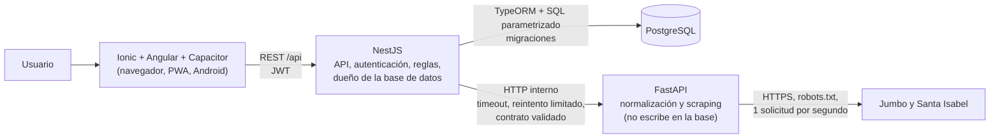

# ADR-004: Arquitectura y justificación de las decisiones principales

**Estado:** Aceptado
**Fecha:** 2026-11-22

## Contexto

La retroalimentación de la EP1 pidió **fortalecer la justificación arquitectónica**. Las decisiones de infraestructura ([ADR-001](001-infraestructura-render.md)), de fuentes ([ADR-002](002-fuentes-datos-web.md)) y de método de scraping ([ADR-003](003-metodo-scraping.md)) ya estaban registradas, pero faltaba explicar por qué la arquitectura general es como es, con qué criterios se compararon las alternativas y qué riesgos se aceptaron.

Este ADR cubre las decisiones transversales. La del recomendador está en [ADR-005](005-recomendador-adaptativo.md).

**Criterios con los que se juzgaron las alternativas** (los mismos en todas las decisiones):

| Criterio | Por qué importa en este proyecto |
|---|---|
| C1. Cumple el enunciado | Arquitectura mínima de la sección 21: Angular, NestJS, API REST, PostgreSQL, autenticación, módulo web, módulo de procesamiento, módulo adaptativo, logs, salud, CI/CD, Docker, infraestructura como código |
| C2. Reproducibilidad | Cualquier persona debe poder levantar el sistema y obtener lo mismo |
| C3. Seguridad y privacidad | Hay datos personales (cuentas, hábitos de comida) y una fuente externa no controlada |
| C4. Testeabilidad | Se evalúa por pruebas automáticas y evidencia, no solo por capturas |
| C5. Costo y alcance | Equipo de dos personas, un semestre, plan gratuito o barato de nube |
| C6. Mantenibilidad | Debe ser comprensible y defendible por quien lo escribió |

## Visión general

## Decisión 1: NestJS como API y único dueño de la base de datos

**Decisión.** Toda la lógica de negocio (autenticación, plan semanal, lista de compras, costo estimado, recomendador, orquestación del scraping) y todo acceso a PostgreSQL viven en NestJS. El frontend solo habla con NestJS.

**Por qué.**

- Un solo punto de entrada concentra la autenticación (JWT), la validación (`ValidationPipe` con `whitelist`), la autorización por usuario y los límites de solicitudes. No hay que replicar controles en otro servicio (C3).
- Un solo dueño del esquema evita que dos servicios cambien las mismas tablas con reglas distintas, y permite que las migraciones sean la única fuente de verdad (decisión 5).
- NestJS aporta inyección de dependencias, módulos, DTOs con `class-validator`, guards y generación de OpenAPI con `@nestjs/swagger`, lo que facilita pruebas unitarias y e2e (C4, C6) y cumple el enunciado (C1).

**Alternativas descartadas.**

| Alternativa | Por qué se descartó |
|---|---|
| Todo en FastAPI (un solo backend) | El enunciado exige NestJS como backend (C1) y FastAPI como servicio especializado; además se perdería la separación entre API y procesamiento |
| Dos servicios con acceso directo a la base | Dos escritores del mismo esquema: riesgo de inconsistencias y de saltarse la autorización (C3) |
| Backend serverless por función | Más complejo de probar y de reproducir en local con Docker Compose (C2, C5) |

**Consecuencias y riesgos.** NestJS es un cuello de botella conceptual: si cae, cae todo. Se mitiga con `/health` (base de datos y servicio Python), con reintentos acotados y con degradación controlada cuando falla Python (el recomendador sigue funcionando sin medir reutilización; los precios guardados siguen disponibles).

## Decisión 2: FastAPI como servicio de procesamiento y scraping que no escribe en la base

**Decisión.** El servicio Python hace dos cosas: normalizar ingredientes (`POST /ingredients/normalize`) y extraer precios de las tiendas (`POST /scrape/search`). **No tiene acceso a la base de datos** (no incluye ningún controlador de PostgreSQL en `requirements.txt`): devuelve sus resultados a NestJS, que los valida y los persiste. En Render es un servicio privado, sin URL pública (ADR-001).

**Por qué.**

- Python tiene el ecosistema adecuado para extracción y procesamiento de texto (`httpx`, `pydantic`) y el enunciado lo pide como módulo separado (C1).
- Separar "obtener y limpiar" de "guardar y servir" permite probar el scraper con páginas congeladas sin base de datos (`python-service/tests/fixtures/`) y probar la persistencia sin internet (C4).
- Si la fuente externa devuelve datos corruptos, hay dos barreras antes de la base: la validación del servicio Python y la de NestJS (decisión 3). Un servicio sin acceso a la base no puede corromperla (C3).
- Aislar el scraping limita el efecto de sus fallos: un timeout o un bloqueo de la tienda no tumban la API.

**Alternativas descartadas.**

| Alternativa | Por qué se descartó |
|---|---|
| Scraper dentro de NestJS | Mezcla responsabilidades y deja sin sentido el módulo Python que exige el enunciado; el procesamiento de texto es más cómodo en Python |
| Python escribe directo en PostgreSQL | Rompe la regla de un solo dueño de la base y duplica la lógica de upsert y deduplicación |
| Cola de mensajes entre NestJS y Python (Redis, RabbitMQ) | Infraestructura adicional que no se justifica con 31 consultas por tienda (C5); la corrida se ejecuta en segundo plano y se consulta por `GET /prices/runs/:id` |

**Consecuencias y riesgos.** La llamada entre servicios es síncrona: una actualización completa tarda más de un minuto (entre 37 y 43 s por tienda en la última corrida, con el scraper a 1 solicitud por segundo; ver [calidad-de-datos.md](calidad-de-datos.md)), por eso se hace en segundo plano. El servicio Python no tiene autenticación propia: depende de ser privado en el despliegue. Si se expusiera, haría falta autenticación de servicio a servicio.

## Decisión 3: contrato validado en ambos lados

**Decisión.** La frontera NestJS y FastAPI tiene un contrato explícito que se valida **en el emisor y en el receptor**:

- FastAPI valida las entradas con Pydantic (`RawIngredient`, `ScrapeRequest`: consultas de 1 a 10, máximo 60 caracteres) y valida cada producto extraído antes de devolverlo (`ProductoScrapeado`: precio entero mayor que cero en CLP, URL del dominio de la tienda, unidad `kg`, `l` o `un`).
- NestJS **no confía** en la respuesta de Python: la revisa con `parseScrapeResponse` ([`scrape-response.ts`](../../backend/src/python-client/scrape-response.ts)); los registros que no cumplen se cuentan como inválidos y se descartan, y una respuesta con forma inválida produce `502 Bad Gateway` sin reintentar.
- Errores: si Python responde con error, NestJS lo propaga con el mismo código; si no responde (caída, timeout), responde `503`. Solo en el segundo caso hay reintento (uno, con espera), porque reintentar un error de validación no sirve.
- Tiempos de espera: 5 s para normalizar, 120 s por lote de scraping (configurable).

**Por qué.** Los dos servicios evolucionan por separado y se despliegan por separado; un cambio incompatible debe fallar con un error claro y no guardar basura (C3, C4). Además, la prueba de integración levanta el servicio Python real y ejecuta el cliente real de NestJS contra él (`backend/test/python-real.integration-spec.ts`, rama `feature/pipeline-staging`).

**Alternativas descartadas.** Compartir un esquema generado (OpenAPI a TypeScript): útil, pero agrega una herramienta de generación y un paso de build; se prefirió un validador pequeño escrito a mano y cubierto por pruebas (`scrape-response.spec.ts`). Validar solo en un lado: deja una frontera sin protección frente a cambios del otro.

**Consecuencias.** El contrato está duplicado (Pydantic y validador manual) y hay que actualizar ambos al cambiarlo; las pruebas de integración detectan la divergencia.

## Decisión 4: PostgreSQL como base de datos

**Decisión.** PostgreSQL 16 con TypeORM.

**Por qué.**

- El dominio es relacional: usuarios, comidas, ingredientes, listas de compra, productos y precios con claves foráneas y borrado en cascada (al borrar la cuenta se borran sus datos, requisito de privacidad).
- Se aprovechan características propias: índices únicos para evitar duplicados (`UQ_productos_slug`, `IDX_precios_tienda_producto_dia`), `INSERT ... ON CONFLICT` para cargas idempotentes por lote, `jsonb` para los errores y descartes de cada ejecución, y `DISTINCT ON` para obtener el último precio de cada producto.
- Es el motor que exige el enunciado (C1) y que Render ofrece administrado (C5).

**Alternativas descartadas.**

| Alternativa | Por qué se descartó |
|---|---|
| MongoDB u otra base documental | El dominio tiene relaciones fuertes y se necesitan restricciones de unicidad e integridad referencial; los precios requieren consultas con agrupación |
| SQLite | No es el motor pedido y no representa un despliegue real con servicios separados |
| Un motor de búsqueda (Elasticsearch) para los productos | Exceso para 31 consultas fijas; no hay búsqueda de texto libre sobre el catálogo |

**Consecuencias.** El historial de precios es de **un registro por producto, tienda y día** (las corridas del mismo día se sobrescriben): suficiente para el precio vigente, limitado para series de tiempo finas. El plan gratuito de PostgreSQL en Render tiene límites de vigencia (ver ADR-001 y [pipeline-y-staging.md](../pipeline-y-staging.md)).

## Decisión 5: migraciones como única fuente de verdad de la estructura

**Decisión.** La estructura de la base de datos de producción **solo** puede salir de las migraciones de `backend/src/migrations/`. En producción `synchronize` está desactivado y `migrationsRun` activado. En desarrollo se mantiene `synchronize` por comodidad, pero el CI comprueba que las migraciones, ejecutadas sobre una base vacía, producen exactamente el esquema de las entidades.

**Por qué.** `synchronize` modifica tablas automáticamente según las entidades, lo que en producción puede borrar datos y no deja historial (C2, C3). Las migraciones son versionadas, revisables y repetibles. Atiende la observación de la EP1 ("garantizar que la estructura final sea reproducible exclusivamente mediante migraciones").

**Cómo se garantiza (rama `feature/ci-auditoria`).** El job `migraciones` del CI parte de una base vacía, ejecuta todas las migraciones y corre `migration:generate --check`, que falla si quedan cambios entre entidades y base. `docker-images` y `deploy-staging` dependen de ese job. Detalle y procedimiento en [migraciones-y-auditoria.md](../migraciones-y-auditoria.md), que vive en esa rama. Ver [correcciones-ep1.md](../correcciones-ep1.md).

**Alternativas descartadas.** `synchronize` también en producción (riesgo de pérdida de datos y sin trazabilidad). Eliminar `synchronize` también en desarrollo (más seguro, pero obliga a escribir una migración por cada ajuste de entidad y ralentiza la iteración; el CI ya cubre el riesgo).

**Consecuencias y riesgos.** El CI no verifica que el método `down` de cada migración funcione ni los datos. Una base de desarrollo creada con `synchronize` no sirve para probar migraciones: hay que usar una base vacía.

## Decisión 6: Ionic, Angular, Capacitor y PWA

**Decisión.** Un solo código Angular con Ionic que se entrega como aplicación web, PWA instalable y app Android (Capacitor). El layout es adaptable: dos árboles de componentes (mobile y desktop) elegidos en tiempo de ejecución por ancho de pantalla.

**Por qué.**

- Angular es obligatorio (C1). Ionic aporta componentes móviles accesibles y Capacitor empaqueta el mismo código para Android, así que el entregable multiplataforma no duplica el trabajo (C5).
- La PWA permite instalar sin tienda y abrir sin conexión (la comparación de precios se guarda con estrategia `freshness`), y mejora el uso en móvil. Detalle en [pwa-y-android.md](../pwa-y-android.md) (rama `feature/pwa-android`).

**Alternativas descartadas.**

| Alternativa | Por qué se descartó |
|---|---|
| App nativa Kotlin o Swift | Duplicaría el desarrollo; el enunciado pide Angular y la entrega es multiplataforma |
| React Native o Flutter | No es el framework exigido y cambiaría toda la base del frontend |
| Solo web responsiva sin Capacitor | No cumple la entrega en Android |

**Consecuencias y riesgos.** Un WebView no tiene el rendimiento de una app nativa. La app Android **no se ha compilado ni probado en un dispositivo** desde el entorno de desarrollo (queda para el workflow de GitHub Actions y para pruebas manuales). La URL del backend en Android requiere una configuración de build absoluta y CORS, pendientes según [pwa-y-android.md](../pwa-y-android.md).

## Decisión 7: recomendador basado en reglas y puntaje, no en aprendizaje automático

Resumen: se eligió una política transparente con dos variables (costo por porción y reutilización de ingredientes) en lugar de un modelo entrenado. Justificación completa, alternativas y riesgos en [ADR-005](005-recomendador-adaptativo.md).

## Otras decisiones relevantes (resumen)

| Tema | Decisión | Dónde |
|---|---|---|
| Autenticación | JWT firmado con HS256 y expiración de 1 hora, contraseñas con bcrypt | `backend/src/auth/`; detalle en `docs/seguridad-privacidad-etica.md` (rama `feature/seguridad`) |
| Observabilidad | Logs JSON con identificador de solicitud que viaja de NestJS a Python, métricas de tiempo y `/health` | Rama `feature/observability` |
| Documentación de la API | OpenAPI con `@nestjs/swagger` en `/api/docs`; FastAPI publica la suya | [docs/api/README.md](../api/README.md) |
| Infraestructura | Terraform y Render, servicio Python privado | [ADR-001](001-infraestructura-render.md) |

## Riesgos de la arquitectura que se aceptan

1. **Dependencia de una fuente externa frágil.** Si las tiendas cambian su HTML o su `robots.txt`, el scraper falla (error `estructura` o `robots`) y se conservan los precios anteriores con su fecha. No hay API oficial alternativa (ADR-002 y 003).
2. **Servicio Python sin autenticación propia.** Protegido solo por red privada.
3. **Contrato duplicado** entre Pydantic y el validador manual de NestJS.
4. **Escalado:** los límites de solicitudes y las métricas viven en memoria; con varias instancias del backend cada una cuenta por separado.
5. **Despliegue real pendiente:** el ambiente de staging definido como código no se ha creado, por lo que parte de las decisiones de despliegue no se han verificado en vivo.
