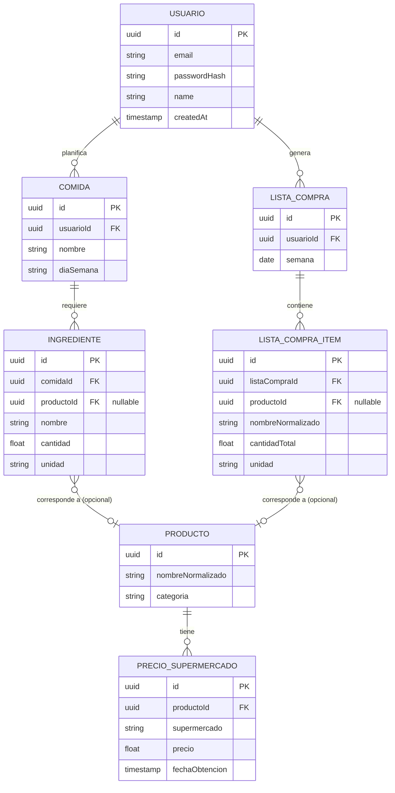
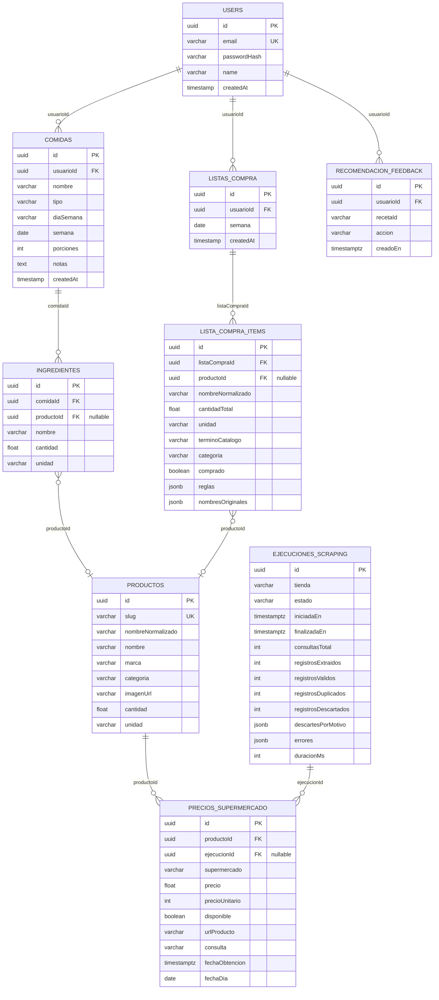

# Modelo de datos

## 1. Modelo conceptual (dominio completo planeado)

Entidades y relaciones que el producto necesita para cumplir su propósito completo
(planificación de comidas + comparación de precios). Algunas todavía no están
implementadas. Se marca explícitamente cuáles.



**Por qué `LISTA_COMPRA_ITEM` y no una relación directa `LISTA_COMPRA`↔`INGREDIENTE`:** una lista de
compras semanal debe consolidar ingredientes repetidos entre varias comidas (por ejemplo, "tomate"
usado en 3 comidas distintas debe aparecer una sola vez, con la cantidad sumada). Un `Ingrediente` no
puede pertenecer a la vez a una `Comida` y a una `ListaCompra`, así que `ListaCompraItem` es una
entidad propia, generada por un proceso de consolidación que recorre las comidas de la semana del
usuario y agrupa por ingrediente/producto. Esto es lo que sostiene la capacidad "adaptativa" de
optimización de compra exigida por el curso.

**Estado de implementación:**

| Entidad | Estado |
|---|---|
| `USUARIO` | ✅ Implementada (`users` table) |
| `COMIDA` | ✅ Esquema implementado (`comidas` table). Endpoints CRUD: Fase 6 |
| `INGREDIENTE` | ✅ Esquema implementado (`ingredientes` table), con FK opcional a `PRODUCTO`. Endpoints CRUD: Fase 6 |
| `PRODUCTO` | ✅ Esquema implementado (`productos` table). Se llena manualmente hasta que exista el scraper (ver ADR-002, EP2) |
| `PRECIO_SUPERMERCADO` | ✅ Esquema implementado (`precios_supermercado` table). Queda vacía hasta que exista el scraper (ver ADR-002, EP2) |
| `LISTA_COMPRA` | ✅ Esquema implementado (`listas_compra` table). Lógica de consolidación: Fase 6 |
| `LISTA_COMPRA_ITEM` | ✅ Esquema implementado (`lista_compra_items` table). Lógica de consolidación: Fase 6 |

## 2. Modelo lógico (implementado hoy)

Refleja las entidades de `backend/src/` y las 5 migraciones de `backend/src/migrations/`.



### Descripción de las tablas

| Tabla | Columnas clave | Notas |
|---|---|---|
| `users` | `id` PK, `email` UK, `passwordHash`, `name`, `createdAt` | Hash bcrypt, nunca contraseña en texto plano |
| `comidas` | `id` PK, `usuarioId` FK, `nombre`, `tipo`, `diaSemana`, `semana`, `porciones` | `onDelete: CASCADE` con `users`. Índice `(usuarioId, semana)`. `semana` es el lunes de la semana |
| `ingredientes` | `id` PK, `comidaId` FK, `nombre`, `cantidad`, `unidad`, `productoId` FK (nullable) | `CASCADE` con `comidas`. Texto libre del usuario, sin normalizar |
| `productos` | `id` PK, `slug` UK, `nombreNormalizado`, `nombre`, `marca`, `categoria`, `cantidad`, `unidad` | Producto real de una tienda. El `slug` (de la URL) es único y lo comparten ambas tiendas. Lo llena el scraper vía NestJS |
| `precios_supermercado` | `id` PK, `productoId` FK, `supermercado`, `precio`, `precioUnitario`, `disponible`, `urlProducto`, `consulta`, `fechaObtencion`, `fechaDia`, `ejecucionId` FK | Procedencia: tienda, fecha, URL y ejecución. Índice único `(supermercado, productoId, fechaDia)`: un precio por producto, tienda y día. Índice por `consulta` |
| `ejecuciones_scraping` | `id` PK, `tienda`, `estado`, `iniciadaEn`, `finalizadaEn`, contadores de consultas y registros, `descartesPorMotivo`, `errores`, `duracionMs` | Una fila por tienda y actualización. Alimenta las métricas de calidad ([calidad-de-datos.md](calidad-de-datos.md)). Índice `(tienda, iniciadaEn)` |
| `listas_compra` | `id` PK, `usuarioId` FK, `semana` | Única por `(usuarioId, semana)`. `CASCADE` con `users` |
| `lista_compra_items` | `id` PK, `listaCompraId` FK, `nombreNormalizado`, `cantidadTotal`, `unidad`, `terminoCatalogo`, `categoria`, `comprado`, `reglas`, `nombresOriginales` | Resultado de normalizar y sumar los ingredientes de la semana ([normalizacion-de-ingredientes.md](normalizacion-de-ingredientes.md)). `reglas` y `nombresOriginales` guardan la trazabilidad |
| `recomendacion_feedback` | `id` PK, `usuarioId` FK, `recetaId`, `accion` (`aceptada` o `rechazada`), `creadoEn` | Única por `(usuarioId, recetaId)`. `CASCADE` con `users` ([capacidad-adaptativa.md](capacidad-adaptativa.md)) |

Entidades definidas en `backend/src/users/entities/`, `backend/src/meals/entities/`,
`backend/src/products/entities/`, `backend/src/prices/entities/`,
`backend/src/shopping-lists/entities/` y `backend/src/recommendations/entities/`.

## 3. Estrategia de migraciones

- ORM: TypeORM, acceso vía `backend/src/data-source.ts`.
- Migraciones en `backend/src/migrations/`, versionadas en git.
- En **desarrollo** (`NODE_ENV != production`) se usa además `synchronize: true` para
  iterar rápido sobre entidades nuevas sin escribir una migración por cada cambio chico.
- En **producción** (`NODE_ENV=production`), `synchronize` se desactiva. El esquema real
  se rige únicamente por las migraciones, que corren automáticamente al arrancar el backend
  (`migrationsRun: true` en `backend/src/app.module.ts`).

Comandos disponibles (`backend/package.json`):

```bash
npm run migration:generate -- src/migrations/NombreDeLaMigracion
npm run migration:run
npm run migration:revert
```

## 4. Inicializar la base de datos

Con Docker Compose (recomendado, ver [README](../README.md)):

```bash
docker compose up -d database
```

Las migraciones corren solas al levantar el contenedor `backend` (no hace falta ningún
paso manual). Para desarrollo local sin Docker, ver las instrucciones de
`backend/README.md`.
