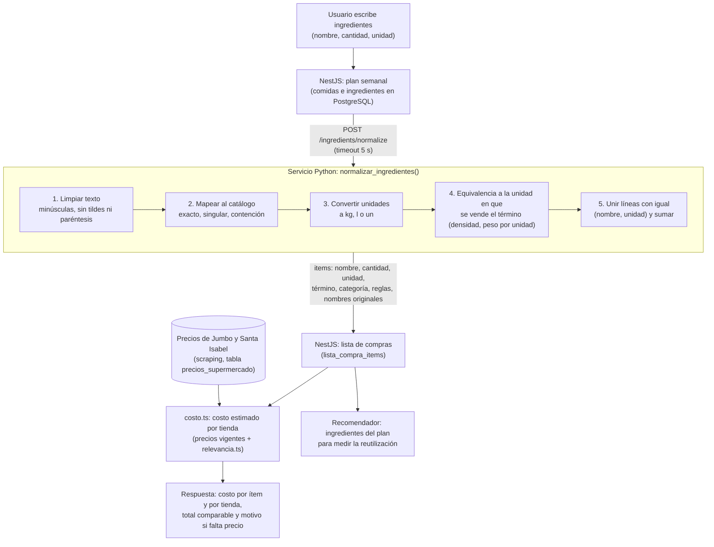

# Normalización de ingredientes

Este documento responde a dos observaciones de la EP1:

- **Documentar las reglas o algoritmos usados para normalizar ingredientes** (secciones 1 a 6).
- **Explicar cómo el procesamiento se usará para generar listas de compras y comparar precios entre supermercados** (sección 7).

Todo lo que sigue sale del código real y los ejemplos se ejecutaron con él (comando en la sección 8).

| Pieza | Archivo |
|---|---|
| Reglas y algoritmo | [`python-service/app/normalizacion.py`](../python-service/app/normalizacion.py) |
| Datos: unidades, descriptores, catálogo, sinónimos, densidades | [`python-service/app/normalizacion_datos.py`](../python-service/app/normalizacion_datos.py) |
| Endpoint | `POST /ingredients/normalize` en [`python-service/app/routers/ingredients.py`](../python-service/app/routers/ingredients.py) |
| Pruebas | [`python-service/tests/test_normalizacion.py`](../python-service/tests/test_normalizacion.py) y [`test_ingredients.py`](../python-service/tests/test_ingredients.py) |
| Catálogo en NestJS (debe coincidir) | [`backend/src/prices/catalogo.ts`](../backend/src/prices/catalogo.ts) |

## 1. Problema que resuelve

El usuario escribe ingredientes como texto libre: `Tomates 500 g`, `tomate 1 kg`, `Tomate cherry 2 unidades`. Para armar una lista de compras y estimar su costo hace falta algo que se pueda **sumar** y **valorizar**:

1. Saber que las tres líneas son el mismo ingrediente.
2. Expresarlas en una unidad común (kg, l o unidad).
3. Saber con qué búsqueda de precios se corresponde (el "término" del catálogo, por ejemplo `tomate`).

El resultado de la normalización es lo que el backend guarda en cada ítem de la lista de compras y lo que usa para buscar precios.

## 2. Flujo



## 3. Reglas, en el orden en que se aplican

Cada línea de entrada pasa por estos pasos. Cada paso deja una **regla trazable** en el campo `rules` de la respuesta, para poder explicar cómo se llegó al resultado.

### 3.1 Limpieza del nombre (`limpiar_texto`)

1. Minúsculas.
2. Se quitan las tildes (normalización Unicode NFD y se descartan las marcas).
3. Se elimina todo lo que esté entre paréntesis.
4. Todo carácter que no sea letra, número o espacio pasa a espacio.
5. Espacios simples.

| Entrada | Salida |
|---|---|
| `  Tomates  ` | `tomates` |
| `Azúcar Blanca` | `azucar blanca` |
| `Cebolla (grande)` | `cebolla` |
| `pollo, entero.` | `pollo entero` |

### 3.2 Descriptores

Son 44 palabras que describen el estado o el tamaño y no cambian qué producto se compra: `fresco`, `picado`, `grande`, `maduro`, `cocido`, `pelado`, `deshuesado`, `entero` (con sus géneros y plurales), `bien`, `finamente`. Se quitan al buscar en el catálogo (`cebolla fresca picada` pasa a `cebolla`). Primero se prueba el nombre completo, porque hay sinónimos que incluyen un descriptor (`carne picada`).

### 3.3 Mapeo al catálogo (`buscar_termino`)

El catálogo tiene **31 términos** con **77 sinónimos** en total. Los términos son los mismos que busca el scraper en cada tienda ([`catalogo.ts`](../backend/src/prices/catalogo.ts)); si se agrega uno en un lado hay que agregarlo en el otro. La búsqueda prueba tres reglas en orden y se detiene en la primera que acierta:

| Orden | Regla (`rules`) | Cómo funciona | Ejemplo |
|---|---|---|---|
| 1 | `nombre:exacto` | El nombre limpio (o sin descriptores) es exactamente un término o un sinónimo | `aguacate` pasa a `palta`; `pechuga de pollo deshuesada` pasa a `pollo` |
| 2 | `nombre:singular` | Lo mismo, pero con la forma singular de la frase (quita `es` si la palabra tiene más de 4 letras, y `s` si tiene más de 3) | `tomates` pasa a `tomate`; `limones` pasa a `limon` |
| 3 | `nombre:contiene(<sinónimo>)` | Todas las palabras de algún sinónimo están dentro del nombre (con sus formas singulares). **Gana el sinónimo con más palabras**, y a igual largo, el primero en orden alfabético | `filete de salmón ahumado` pasa a `salmon` por `contiene(filete de salmon)` |

Dos propiedades que las pruebas verifican:

- **Gana el sinónimo más largo:** `salsa de tomate casera` se resuelve como `salsa de tomate` y no como `tomate`.
- **Se comparan palabras, no letras:** `salsa verde` no se confunde con `sal`.

Si ninguna regla acierta, el ingrediente queda **sin término** (`term: null`): se conserva con su nombre limpio y se informa, pero no se podrá valorizar.

### 3.4 Conversión de unidades (`convertir_cantidad`)

Primero se lleva la cantidad a la **unidad base de su tipo**. Hay 46 alias de unidades reconocidos:

| Tipo | Base | Alias y factor |
|---|---|---|
| Masa | kg | `kg`, `kilo(s)`, `kilogramo(s)` x1; `g`, `gr`, `grs`, `gramo(s)` x0,001; `mg` x0,000001 |
| Volumen | l | `l`, `lt`, `lts`, `litro(s)` x1; `ml`, `cc`, `mililitro(s)` x0,001; `cl` x0,01; `cucharada(s)`, `cda(s)` x0,015; `cucharadita(s)`, `cdita(s)` x0,005; `taza(s)` x0,24; `vaso(s)` x0,2 |
| Conteo | un | `un`, `u`, `ud(s)`, `unid`, `unidad(es)`, `pieza(s)`, `diente(s)` x1; `docena(s)` x12 |

La regla queda registrada: `unidad:g->kg(x0.001)`. Si la unidad no está en la tabla (`pizcas`, `lata`), la cantidad **no se convierte**: se deja tal cual y se anota `unidad:desconocida(pizcas)`.

### 3.5 Equivalencias por densidad y peso por unidad

Muchos ingredientes se escriben en una unidad distinta a la que usan las tiendas para el precio unitario (el arroz se vende por kg, pero la receta dice "1 taza"). Si la base de la cantidad no coincide con la base en que se vende el término, se convierte con datos propios del término:

| De | A | Dato usado | Cuenta | Regla (`rules`) |
|---|---|---|---|---|
| kg | l | `densidad_kg_por_l` | kg / densidad | `equivalencia:kg->l[densidad(0.91kg/l)]` |
| l | kg | `densidad_kg_por_l` | l x densidad | `equivalencia:l->kg[densidad(0.85kg/l)]` |
| un | kg | `peso_unidad_kg` | un x peso | `equivalencia:un->kg[peso_unidad(0.15kg)]` |
| kg | un | `peso_unidad_kg` | kg / peso | `equivalencia:kg->un[peso_unidad(0.3kg)]` |
| l | un | densidad y peso | l x densidad / peso | `equivalencia:l->un[densidad_y_peso_unidad]` |

Cobertura de los datos: 12 de los 31 términos tienen densidad (arroz 0,85 kg/l, harina 0,5, azúcar 0,83, aceite 0,91, leche 1,03...) y 10 tienen peso por unidad (tomate 0,15 kg, cebolla 0,2, palta 0,2, limón 0,1, pan 0,09...). Los valores son aproximaciones razonables, no mediciones.

Si hace falta una equivalencia y el término no tiene el dato (por ejemplo "2 unidades" de `zapallo`), la cantidad se deja en su unidad y se anota `equivalencia:faltante(un->kg)`. No se inventa un número.

### 3.6 Unión de líneas (`normalizar_ingredientes`)

Las líneas que quedaron con el mismo **nombre** (el del término, o el nombre limpio si no hay término) y la **misma unidad** se suman. Se conserva el orden de primera aparición, se acumulan las reglas sin repetirlas, se guardan los nombres originales y se cuenta cuántas líneas se unieron (`merged_lines`). La cantidad final se redondea a 4 decimales, para que 4 g de levadura no desaparezcan.

Dos líneas del mismo término con unidades que no se pudieron igualar **no se suman** (`zapallo` 1 kg y `zapallo` 2 unidades quedan como dos ítems), porque sumarlas sería inventar una conversión.

## 4. Contrato de la API

Entrada (`RawIngredient`): `name` (texto no vacío), `quantity` (mayor que 0) y `unit` (texto no vacío). Lista de al menos 1 elemento. Si algo no cumple, FastAPI responde 422 y el backend lo propaga.

Salida (`NormalizedIngredient`):

| Campo | Contenido |
|---|---|
| `name` | Nombre del término del catálogo, o el nombre limpio si no hubo |
| `quantity`, `unit` | Cantidad total ya convertida y su unidad (`kg`, `l`, `un`, o la original si no se pudo convertir) |
| `term`, `category` | Término del catálogo de precios y su categoría, o `null` |
| `rules` | Reglas aplicadas, en orden |
| `original_names` | Cómo lo escribió el usuario |
| `merged_lines` | Cuántas líneas se unieron |

La especificación completa está en [`docs/api/openapi-python.json`](api/openapi-python.json).

## 5. Ejemplos reales (entrada y salida)

Salidas obtenidas ejecutando `normalizar_ingredientes` (ver sección 8). Se muestran los campos relevantes.

| Entrada (nombre, cantidad, unidad) | Salida (`name`, `quantity`, `unit`) | `rules` |
|---|---|---|
| `Cebolla FRESCA (grande) picada`, 2, `unidades` | `cebolla`, 0.4, `kg` | `nombre:exacto`, `unidad:unidades->un(x1)`, `equivalencia:un->kg[peso_unidad(0.2kg)]` |
| `arroz`, 500, `g` | `arroz`, 0.5, `kg` | `nombre:exacto`, `unidad:g->kg(x0.001)` |
| `pechuga de pollo deshuesada`, 1, `kg` | `pollo`, 1.0, `kg` | `nombre:exacto` |
| `Tomates`, 4, `unidades` | `tomate`, 0.6, `kg` | `nombre:singular`, `unidad:unidades->un(x1)`, `equivalencia:un->kg[peso_unidad(0.15kg)]` |
| `filete de salmón ahumado`, 300, `g` | `salmon`, 0.3, `kg` | `nombre:contiene(filete de salmon)`, `unidad:g->kg(x0.001)` |
| `salsa de tomate casera`, 1, `taza` | `salsa de tomate`, 0.252, `kg` | `nombre:contiene(salsa de tomate)`, `unidad:taza->l(x0.24)`, `equivalencia:l->kg[densidad(1.05kg/l)]` |
| `arroz`, 1, `taza` | `arroz`, 0.204, `kg` | `nombre:exacto`, `unidad:taza->l(x0.24)`, `equivalencia:l->kg[densidad(0.85kg/l)]` |
| `aceite de oliva`, 2, `cucharadas` | `aceite`, 0.03, `l` | `nombre:exacto`, `unidad:cucharadas->l(x0.015)` |
| `lechuga`, 0.6, `kg` | `lechuga`, 2.0, `un` | `nombre:exacto`, `equivalencia:kg->un[peso_unidad(0.3kg)]` |
| `huevos`, 1, `docena` | `huevos`, 12.0, `un` | `nombre:exacto`, `unidad:docena->un(x12)` |
| `zapallo`, 2, `unidades` | `zapallo`, 2.0, `un` | `nombre:exacto`, `unidad:unidades->un(x1)`, `equivalencia:faltante(un->kg)` |
| `sal`, 3, `pizcas` | `sal`, 3, `pizcas` | `nombre:exacto`, `unidad:desconocida(pizcas)` |
| `Cilantro`, 1, `cucharada` y `cilantro`, 2, `cda` | `cilantro`, 0.045, `l` (`term: null`, 2 líneas unidas) | `unidad:cucharada->l(x0.015)`, `unidad:cda->l(x0.015)` |

**Unión de líneas.** Entrada: `Tomates` 500 g, `tomate` 1 kg y `Tomate cherry` 2 unidades. Salida: un solo ítem.

```json
{
  "name": "tomate",
  "quantity": 1.8,
  "unit": "kg",
  "term": "tomate",
  "category": "frutas y verduras",
  "rules": ["nombre:singular", "unidad:g->kg(x0.001)", "nombre:exacto",
            "unidad:unidades->un(x1)", "equivalencia:un->kg[peso_unidad(0.15kg)]"],
  "original_names": ["Tomates", "tomate", "Tomate cherry"],
  "merged_lines": 3
}
```

(0,5 kg + 1 kg + 2 unidades x 0,15 kg = 1,8 kg.)

## 6. Limitaciones conocidas

El mapeo es **léxico, no semántico**: compara palabras, no entiende qué es el producto. Casos reales comprobados:

| Entrada | Resultado | Problema |
|---|---|---|
| `leche condensada`, 200, `ml` | `leche`, 0.2 l (`nombre:contiene(leche)`) | Es otro producto, pero contiene la palabra `leche` |
| `pasta de tomate`, 100, `g` | `fideos`, 0.1 kg (`nombre:contiene(pasta)`) | `pasta` es sinónimo de `fideos`, y aquí significa concentrado de tomate |
| `aceite de coco`, 1, `l` / `aceite de oliva` | `aceite` | Todo aceite se valoriza como el de menor precio por litro (en la prueba real, un aceite vegetal de 5 L) |
| `harina de maiz`, 1, `kg` | `harina` | Se valoriza como harina de trigo |
| `cilantro`, `levadura`, `salsa de soya`, `salsa verde` | sin término | No están en el catálogo de 31 términos: no se pueden valorizar |
| `sal`, 3, `pizcas`; `leche`, 1, `lata` | unidad sin convertir | Unidades fuera de la tabla (`pizcas`, `lata`, "al gusto") |
| `zapallo`, `pollo`, `queso`, `atun`, `merluza`... en unidades | sin equivalencia | 8 términos que se venden por kg no tienen peso por unidad ni densidad |

Otras limitaciones:

- **Catálogo pequeño:** 31 términos. Lo que no está queda sin precio (con el motivo `sin_termino` en la lista de compras).
- **Todos los productos de un término se tratan igual:** `tomate cherry` y `tomate` suman con el mismo peso por unidad de 0,15 kg.
- **Densidades y pesos por unidad aproximados**, iguales para cualquier variedad o marca.
- **Singular simple:** la regla de plurales solo quita `s` o `es`. No cubre irregulares ni regionalismos que no estén como sinónimo.
- **Sin corrección ortográfica** ni coincidencia aproximada: `tomatess` no se reconoce.
- **No distingue cortes ni preparación** más allá de los 44 descriptores.

Cómo se mitiga: el ítem conserva `nombresOriginales` y `reglas`, por lo que se puede ver de dónde salió cada cantidad; los ítems que no se pueden valorizar lo dicen (sección 7.2), y el costo nunca inventa un precio. Mejorar la precisión pasa por ampliar sinónimos y el catálogo, no por cambiar el algoritmo.

## 7. Cómo la normalización alimenta la lista de compras y la comparación de precios

### 7.1 De las comidas a la lista de compras

`POST /api/shopping-lists/generate` ([`shopping-lists.service.ts`](../backend/src/shopping-lists/shopping-lists.service.ts)):

1. Junta los ingredientes de todas las comidas de la semana del usuario.
2. Los envía al servicio Python (`POST /ingredients/normalize`). El servicio Python **no escribe en la base**: devuelve el resultado a NestJS.
3. En una transacción reemplaza la lista de esa semana y guarda un ítem por cada resultado: `nombreNormalizado`, `cantidadTotal`, `unidad`, `terminoCatalogo`, `categoria`, `reglas` y `nombresOriginales`. Lo que el usuario ya había marcado como comprado se conserva si el ítem sigue en la lista.
4. Si no hay ingredientes planificados, responde 422.

Por eso "Tomates 500 g", "tomate 1 kg" y "Tomate cherry 2 unidades" se transforman en **una** línea de 1,8 kg en la lista, con el detalle de cómo se llegó a esa cantidad.

### 7.2 Del ítem al costo estimado por tienda

`GET /api/shopping-lists` valoriza cada ítem con los precios vigentes (último precio guardado de cada producto en cada tienda). La clave de unión entre ambos mundos es el **término del catálogo**: el scraper guarda cada producto con la consulta (`consulta`) con la que se encontró, y la normalización produce ese mismo término.

Para cada ítem y cada tienda ([`costo.ts`](../backend/src/shopping-lists/costo.ts)):

1. Sin `terminoCatalogo`, no hay precio: motivo `sin_termino`.
2. De los productos de esa consulta, se descartan los no disponibles y los que no son relevantes ([`relevancia.ts`](../backend/src/shopping-lists/relevancia.ts)). Si no queda ninguno: `sin_precio_en_tienda`.
3. Solo compiten los productos cuyo **precio unitario está en la misma unidad que el ítem** (kg con kg, l con l, un con un). Si hay productos pero ninguno cumple: `unidad_no_comparable`. Por eso importa que la normalización deje la cantidad en la unidad en que se vende el término: un ítem en kg nunca se valoriza con un precio por unidad.
4. Se elige el de menor precio unitario y el costo es `round(precioUnitario x cantidad)`. Se marca `desactualizado` si el precio tiene más horas que `PRICES_STALE_HOURS` (48 por defecto).

El filtro de relevancia existe porque la búsqueda de la tienda devuelve productos "parecidos" y el más barato por kilo suele ser un derivado (un puré, una salsa). Descarta los que no nombran al ingrediente (con una lista de alternativas, como `tallarin` para `fideos` o `trutro` para `pollo`) y los que contienen palabras de procesado (`pure`, `salsa`, `jugo`, `pasta`, `snack`...). Es una heurística por nombre: reduce los errores, no los elimina.

**Totales y comparación entre tiendas.** El resumen de la lista suma los totales por tienda **solo sobre los ítems que tienen precio en ambas tiendas** (`itemsComparables`), porque comparar un total donde a una tienda le faltan ítems favorecería a la que tiene menos datos. Informa cuál es más barata y el ahorro, y cuántos ítems quedaron sin precio.

Resultado real con el usuario de prueba (ensalada con tomates, cebolla, palta, aceite, leche condensada, cilantro, más arroz con pollo; precios del 21-11-2026):

| Ítem normalizado | Jumbo | Santa Isabel | Observación |
|---|---|---|---|
| `tomate` 0,8 kg | $1.672 (Tomate Larga Vida Malla 1 kg) | $6.048 (Tomate Cóctel Pote 250 g) | Las dos tiendas no comparan el mismo tipo de tomate |
| `arroz` 0,4 kg | $396 | $396 | Empate |
| `cebolla` 0,4 kg | $836 | $820 | |
| `cilantro` 0,015 l | sin precio (`sin_termino`) | sin precio (`sin_termino`) | No está en el catálogo |
| `zanahoria` 0,2 kg | $318 | $2.391 | Santa Isabel eligió un producto de comida infantil que contiene zanahoria (ver limitación) |

Resumen devuelto: 9 ítems, 8 comparables, 1 sin precio, total Jumbo $8.318, total Santa Isabel $14.509, más barata Jumbo.

**Esto muestra el límite del método, y se documenta como tal:** el total de Santa Isabel está inflado por dos productos poco representativos (el tomate cóctel y un picado infantil con zanahoria). El filtro de relevancia no descartó el segundo porque ninguna de sus palabras está en la lista de procesados. La estimación es útil como orden de magnitud y para detectar diferencias grandes, no como cifra exacta.

### 7.3 Comparación de precios sin pasar por la lista

`GET /api/prices/compare` ([`compare.ts`](../backend/src/prices/compare.ts), [`prices.service.ts`](../backend/src/prices/prices.service.ts)) trabaja directamente sobre el catálogo, sin normalización de ingredientes:

- **Por término:** el mejor producto disponible de cada tienda por precio unitario, y el veredicto (`jumbo`, `santa_isabel`, `empate`, `no_comparable` si falta precio unitario o difieren las unidades, `null` si falta una tienda).
- **Productos idénticos** presentes en las dos tiendas (mismo `slug` de la URL), ordenados por diferencia de precio. Es la comparación más exacta posible, porque es el mismo producto.

Esta ruta **no** aplica el filtro de relevancia de `relevancia.ts` (solo lo usa el costo de la lista y el de las recetas). Los datos reales del 21-11-2026 dieron 26 términos comparables de 31: Santa Isabel más barata en 15, Jumbo en 8, empate en 3 y 5 no comparables.

### 7.4 Del ítem a la recomendación

El recomendador usa la misma normalización para saber qué ingredientes ya están en el plan: normaliza las comidas de la semana y se queda con los términos. Así "Tomates" y "tomate" cuentan igual al medir cuánto reutiliza una receta. Si el servicio Python no responde, sigue funcionando sin medir reutilización (degradación controlada). Ver [capacidad-adaptativa.md](capacidad-adaptativa.md).

## 8. Cómo reproducir los ejemplos

Desde `python-service/`, con las dependencias instaladas (`pip install -r requirements-dev.txt`):

```bash
# bash
python -c "
import sys; sys.path.insert(0, '.')
from app.normalizacion import IngredienteEntrada, normalizar_ingredientes
r = normalizar_ingredientes([IngredienteEntrada('Tomates', 500, 'g'), IngredienteEntrada('tomate', 1, 'kg'), IngredienteEntrada('Tomate cherry', 2, 'unidades')])
print(r)
"
pytest tests/test_normalizacion.py -v
```

```powershell
# PowerShell
python -c "import sys; sys.path.insert(0, '.'); from app.normalizacion import IngredienteEntrada, normalizar_ingredientes; print(normalizar_ingredientes([IngredienteEntrada('Tomates', 500, 'g'), IngredienteEntrada('tomate', 1, 'kg'), IngredienteEntrada('Tomate cherry', 2, 'unidades')]))"
pytest tests/test_normalizacion.py -v
```

O llamando al endpoint con el servicio levantado (`uvicorn app.main:app --port 8000`):

```bash
curl -s -X POST http://localhost:8000/ingredients/normalize -H "Content-Type: application/json" \
  -d '{"ingredients":[{"name":"Tomates","quantity":500,"unit":"g"},{"name":"tomate","quantity":1,"unit":"kg"}]}'
```

Si se escriben tildes en la consola de Windows, definir antes `$env:PYTHONUTF8 = "1"` para evitar caracteres rotos.

## 9. Pruebas que respaldan este documento

`python-service/tests/test_normalizacion.py` cubre: limpieza, mapeo exacto, singular y por contención, sinónimo más largo, no confundir `salsa` con `sal`, cada conversión de unidad (gramos, ml, taza, unidades, docena, kg a unidades, masa a litros), equivalencia faltante, unidad desconocida, unión de líneas, orden de aparición, reglas trazables, y que **todo término y todo sinónimo del catálogo se mapea a sí mismo**. `test_ingredients.py` prueba el endpoint (unión de duplicados, rechazo de cantidades inválidas, nombres vacíos y listas vacías).
