# Pipeline de CI/CD y despliegue a staging

Este documento describe cómo se validan los cambios, cómo se despliegan a staging
(Render) y cómo se revierten. Los workflows están en `.github/workflows/` y los scripts
que usan en `.github/scripts/`.

> **Estado:** el pipeline y los scripts están listos, pero el ambiente de staging en
> Render todavía no existe (`terraform apply` no se ha ejecutado). Hasta completar los
> [pasos manuales](#pasos-manuales-pendientes), el job `deploy-staging` falla en su primer
> paso con un mensaje que lista qué falta configurar. Los demás jobs funcionan hoy.

## Vista general

```mermaid
flowchart LR
    Push["push / pull request"] --> Calidad

    subgraph Calidad["Jobs de calidad (en paralelo)"]
        BE["backend<br/>lint, build, unit, e2e, audit"]
        MIG["migraciones<br/>base vacia, sin deriva"]
        FE["frontend<br/>lint, build, unit, audit"]
        PY["python-service<br/>ruff, bandit, pytest,<br/>recuperacion, pip-audit"]
        INT["integracion-python<br/>NestJS contra FastAPI real"]
        TF["terraform<br/>fmt y validate"]
        SEC["secrets-scan<br/>gitleaks"]
    end

    Calidad --> IMG["docker-images<br/>build + Trivy"]
    IMG --> Rama{"push a develop?"}
    Rama -- "no (PR u otra rama)" --> Fin["termina"]
    Rama -- si --> Deploy

    subgraph Deploy["deploy-staging (environment: staging)"]
        D1["1. deploy Python"] --> D2["2. deploy backend"] --> D3["3. deploy frontend"]
        D3 --> H["health checks"]
    end

    H -- falla --> Rollback["Rollback de staging<br/>(manual, por SHA)"]
```



## Jobs de `ci.yml`

| Job | Qué valida | Corre en |
|---|---|---|
| `backend` | Lint, build, pruebas unitarias, e2e contra PostgreSQL real (con el servicio Python simulado), `npm audit` (falla con severidad alta o crítica) | todo push y PR |
| `migraciones` | Ejecuta todas las migraciones sobre una base vacía y falla si quedan entidades sin migración (ver [migraciones-y-auditoria.md](migraciones-y-auditoria.md)) | todo push y PR |
| `frontend` | Lint, build, pruebas unitarias, `npm audit` (falla con severidad alta o crítica) | todo push y PR |
| `python-service` | `ruff`, `bandit`, `pytest` completo, pruebas de recuperación del scraper, `pip-audit` | todo push y PR |
| `integracion-python` | Pruebas de integración NestJS y FastAPI con el servicio Python real | todo push y PR |
| `terraform` | `terraform fmt -check`, `init -backend=false`, `validate` | todo push y PR |
| `secrets-scan` | gitleaks sobre todo el historial | todo push y PR |
| `docker-images` | Construye las 3 imágenes y las escanea con Trivy (CRITICAL y HIGH) | todo push y PR, si los anteriores pasan |
| `deploy-staging` | Despliega a Render y verifica la salud | solo push a `develop`, si pasa todo lo anterior |

El workflow usa `permissions: contents: read` y las acciones de terceros están fijadas por
SHA de commit (con la versión como comentario). Para actualizarlas, resolver el SHA del
nuevo tag y cambiar ambos.

### Pruebas que exige la entrega

**1. Pruebas de Python.** El job `python-service` corre `pytest` completo (más de 140 pruebas:
salud, normalización de ingredientes, endpoint `/scrape/search`, parser, normalizador,
robots.txt, servicio del scraper, observabilidad), con un mínimo de 90% de cobertura.

**2. Integración NestJS y FastAPI.** El job `integracion-python` levanta el servicio
Python real con `uvicorn tests.servidor_integracion:app` y ejecuta
`backend/test/python-real.integration-spec.ts` con
`npx jest --config ./test/jest-integration.json`. Esas pruebas usan el cliente HTTP real
del backend (`PythonClientService`) y su validador de contrato (`parseScrapeResponse`)
contra el servicio por HTTP real:

- `/health` del servicio Python.
- `/ingredients/normalize`: suma de ingredientes repetidos.
- `/scrape/search` en Jumbo y Santa Isabel: contrato válido, 0 registros inválidos.
- Rechazo de solicitudes inválidas (422 de FastAPI propagado por NestJS).

El servidor de integración (`python-service/tests/servidor_integracion.py`) es la
aplicación de producción sin cambios, salvo que el cliente HTTP del scraper usa un
transporte simulado que responde con las páginas congeladas de
`python-service/tests/fixtures/`. Así el parser y el contrato son los reales y **no se
accede a internet ni a las tiendas**. Esta prueba no necesita base de datos.

**3. Pruebas de recuperación.** Hay tres grupos y todos corren en CI:

| Dónde | Prueba | Escenario |
|---|---|---|
| `python-service` (paso "Pruebas de recuperación del scraper") | `test_timeout_reintenta_y_termina_como_fallido` | Timeout de la tienda: 1 intento más 2 reintentos y termina como `fallido` |
| | `test_error_de_servidor_se_recupera_si_el_reintento_funciona` | La tienda responde 503 una vez y el reintento tiene éxito |
| | `test_bloqueo_429_no_se_reintenta` | Bloqueo 429: no se insiste |
| | `test_pagina_sin_estructura_esperada_se_reporta_como_estructura` | La tienda cambió su HTML |
| | `test_robots_no_disponible_impide_scrapear` | robots.txt inaccesible: no se scrapea |
| | `test_estado_parcial_cuando_falla_solo_una_consulta` | Una consulta falla y las demás se conservan (estado `parcial`) |
| | `test_redireccion_fuera_del_dominio_se_rechaza` y `test_respuesta_demasiado_grande_se_rechaza` | Respuestas inválidas de la tienda |
| `integracion-python` | "recuperación: si una consulta falla..." | Estado `parcial` extremo a extremo sobre HTTP real |
| | "recuperación: si la tienda cae (503)..." | Estado `fallido` con el error reportado, sin tumbar la respuesta |
| | "recuperación: con el servicio Python caído..." | Con Python inalcanzable NestJS responde `503 ServiceUnavailable` en vez de colgarse |
| `backend` (paso e2e, `backend/test/prices.e2e-spec.ts`) | "si el servicio Python no responde, la corrida falla pero los datos anteriores siguen disponibles" | Caída de Python durante una actualización de precios: la corrida queda `fallido` y los precios previos siguen consultables |

## Despliegue automático a staging

El job `deploy-staging` solo corre en **push a `develop`** y solo si todos los jobs de
calidad pasaron (incluido el escaneo de imágenes). Usa `environment: staging` y la
concurrencia `staging-deploy`, de modo que dos despliegues nunca se solapan.

1. Verifica que estén configurados el secret y las variables (ver abajo). Si falta algo,
   falla de inmediato y dice cuál.
2. Despliega, **en orden**, servicio Python, backend y frontend. El backend necesita a
   Python y el frontend necesita al backend. Los tres reciben el SHA exacto del push
   (`commitId` de la API de Render), no "lo último de la rama", así el ambiente es
   reproducible y consistente. Cada paso espera a que el deploy quede `live` (máximo 15
   minutos por servicio) y falla si Render reporta `build_failed`, `update_failed`,
   `pre_deploy_failed`, `canceled` o `deactivated`.
3. Ejecuta los health checks con reintentos (30 intentos cada 10 s, porque un servicio
   recién desplegado o dormido en un plan gratuito tarda en responder):

| Verificación | URL | Criterio |
|---|---|---|
| Backend, PostgreSQL y servicio Python | `<backend>/health` | HTTP 200 y `status: "ok"` |
| Frontend | `<frontend>/` | HTTP 200 |
| Proxy del frontend al backend | `<frontend>/api/` | HTTP 200 (comprueba `BACKEND_URL`) |
| Servicio Python directo (opcional) | `<python>/health` | HTTP 200 y `status: "ok"` |

Si cualquier paso falla, el job falla y el commit queda marcado en rojo. El servicio
Python es un servicio web con clave de servicio (ADR-001, actualización del 22-11-2026). Su salud
se verifica a través del backend, cuyo `/health` informa el estado de PostgreSQL y de Python. El
check directo (`<python>/health`, que no exige clave) solo corre si se define `STAGING_PYTHON_URL`,
con el output `python_service_url` de Terraform.

> **Ruta del health check del backend.** El backend excluye `health` del prefijo global
> (`backend/src/setup-app.ts`), por lo que la ruta real es `/health` y **no**
> `/api/health`. El pipeline usa la ruta real. Si se cambia en el backend, actualizar
> `ci.yml`, `rollback-staging.yml` y `infra/services.tf` (`health_check_path`).

### Cómo desplegar

- **Normal:** hacer merge de un PR a `develop`. El pipeline hace el resto.
- **Volver a desplegar el mismo commit** (por ejemplo, si Render falló por algo externo):
  en GitHub, Actions, run del commit, "Re-run failed jobs".

### Por qué `auto_deploy = false` en Terraform

Con `auto_deploy = true`, Render despliega en cada push a `develop` por su cuenta, sin
esperar al CI, y además lo dispararía el pipeline (doble despliegue y un commit sin
validar llegando a staging). Con `false`, el único camino a staging es el pipeline.

## Rollback

Hay dos formas. Ambas dejan los tres servicios en un commit conocido.

### Opción A: workflow "Rollback de staging" (recomendada)

1. Identificar el último commit bueno: en GitHub, Actions, el último run verde de `CI` en
   `develop`, o `git log develop`. Copiar el SHA **completo** (40 caracteres).
2. Actions, "Rollback de staging", "Run workflow". Indicar el SHA y, si el problema es
   de un solo servicio, elegir `solo-backend`, `solo-frontend` o `solo-python`; si no,
   `todos`.
3. El workflow redespliega ese commit en el orden Python, backend, frontend y corre los
   mismos health checks. No corre las pruebas, porque su objetivo es recuperar rápido.
4. Dejar `develop` coherente: hacer `git revert` del commit defectuoso y subirlo por PR.
   Mientras no se haga, el siguiente push a `develop` volverá a desplegar el código malo.

### Opción B: desde el panel de Render

Servicio, pestaña Deploys, elegir un deploy anterior en estado `live` y "Rollback" (o
"Redeploy"). Es la vía más rápida si GitHub Actions no está disponible. Repetirlo en cada
servicio afectado y confirmar con `<backend>/health`.

### Limitaciones del rollback

- **Migraciones de base de datos.** En producción el backend corre las migraciones al
  arrancar (`migrationsRun`), pero revertir el código **no** revierte el esquema. Si el
  commit defectuoso trajo una migración, hay que revertirla a mano
  (`npm run migration:revert` apuntando a la base de staging) antes o después del
  rollback, según sea compatible con el código anterior.
- Un rollback de Render no cambia variables de entorno. Si el problema fue una variable,
  corregirla en el panel o en Terraform.

## Docker Compose y Render: el proxy del frontend

nginx hace proxy de `/api/` al backend. El destino ya no está escrito en el archivo:
`frontend/nginx.conf.template` usa `${BACKEND_URL}` y la imagen oficial de nginx lo
sustituye al arrancar (`envsubst`), solo esa variable.

| Ambiente | `BACKEND_URL` |
|---|---|
| Docker Compose | `http://backend:3000` (valor por defecto de la imagen y de `docker-compose.yml`) |
| Render | URL pública del backend, sin barra final, por ejemplo `https://menusmart-staging-backend.onrender.com` (output `backend_url` de Terraform) |

El proxy envía como `Host` el del destino (`$proxy_host`) y activa SNI, porque Render
enruta por `Host` y el destino es HTTPS.

## Terraform

`infra/` define la base de datos y los tres servicios. Relaciones relevantes:

- Frontend: `BACKEND_URL` = URL pública del backend; `PORT=80`.
- Backend: `PYTHON_SERVICE_URL` = URL pública del servicio Python, `PYTHON_SERVICE_KEY` = la
  clave compartida (`python_service_key`), `PYTHON_TIMEOUT_MS` = 90 s con instancias gratuitas
  y `DATABASE_URL` interna.
- Python: `SERVICE_API_KEY` = la misma clave. Sin ella, no se exige nada.
- `instance_plan` (por defecto `free`) fija el plan de los tres servicios. La base de datos
  es siempre `free` y caduca a los 30 días.
- Los `outputs` entregan las URLs y los IDs de servicio que hay que copiar a GitHub.

### Servicios gratuitos: qué esperar

- **Se duermen** tras 15 minutos sin tráfico y la primera visita tarda cerca de un minuto en
  despertarlos. Una demostración en vivo se arruina si el servicio está dormido: **abre el frontend
  y haz una lista de compras 5 a 10 minutos antes** para despertar frontend, backend y Python.
- El deploy desde GitHub puede tardar más y el health check ya reintenta 30 veces cada 10 s.
- Las instancias gratuitas de un workspace comparten un cupo de horas al mes (750 h); dormidas
  no consumen.
- Para pasar a instancias de pago basta cambiar `instance_plan = "starter"` en `terraform.tfvars`
  y ejecutar `terraform apply`.
- Al terminar la presentación, `terraform destroy` borra todo.

El job `terraform` del CI corre `fmt -check`, `init -backend=false` y `validate`. **Nunca**
ejecuta `plan` ni `apply`: no tiene credenciales de Render y aplicar infraestructura debe
ser una acción deliberada.

## Secrets y variables de GitHub

Todos se crean en el environment **`staging`** (Settings, Environments, staging), no a
nivel de repositorio, para que solo el job de despliegue pueda leerlos.

| Nombre | Tipo | Valor |
|---|---|---|
| `RENDER_API_KEY` | Secret | API key de Render (Account Settings, API Keys) |
| `RENDER_SERVICE_ID_PYTHON` | Variable | ID `srv-...` del servicio Python (output `render_service_id_python`) |
| `RENDER_SERVICE_ID_BACKEND` | Variable | ID `srv-...` del backend (output `render_service_id_backend`) |
| `RENDER_SERVICE_ID_FRONTEND` | Variable | ID `srv-...` del frontend (output `render_service_id_frontend`) |
| `STAGING_BACKEND_URL` | Variable | URL pública del backend, sin barra final (output `backend_url`) |
| `STAGING_FRONTEND_URL` | Variable | URL pública del frontend, sin barra final (output `frontend_url`) |
| `STAGING_PYTHON_URL` | Variable (opcional) | Solo si el servicio Python es alcanzable desde internet |

El secret `JWT_SECRET_TEST` que usa el job `backend` es opcional: si no existe, el CI usa
valores de prueba que no son reales.

Los secrets de la aplicación en Render (`JWT_SECRET`, `DATABASE_URL`) los gestiona
Terraform a partir de `terraform.tfvars` (que no se commitea) y no pasan por GitHub.

## Pasos manuales pendientes

Esto no se puede hacer desde el repositorio y le corresponde a Jan:

1. **Crear la cuenta de Render** y generar una **API key** y el **owner id** (`usr-...` o
   `tea-...`).
2. **Crear la infraestructura** (una sola vez, de forma controlada):
   ```bash
   cd infra
   cp terraform.tfvars.example terraform.tfvars   # completar render_api_key, render_owner_id y jwt_secret
   terraform init
   terraform plan
   terraform apply
   terraform output
   ```
   `terraform.tfvars` está en `.gitignore`; no commitearlo.
3. **Crear el environment `staging`** en GitHub y cargar el secret y las variables de la
   tabla anterior con los valores de `terraform output`. Opcional: agregar revisores
   requeridos al environment para aprobar cada despliegue.
4. **Proteger las ramas** `develop` y `main` (Settings, Branches): exigir pull request y
   que pasen los checks `Backend - lint, build, pruebas`, `Frontend - lint, build, pruebas`,
   `Python - lint, pruebas`, `Integracion NestJS - FastAPI (servicio Python real)`,
   `Terraform - fmt y validate`, `Deteccion de secretos (gitleaks)` y
   `Build y escaneo de imagenes Docker`.
5. **Primer despliegue:** hacer merge a `develop` y revisar el run de `CI`.
6. **Probar el rollback una vez** con el workflow "Rollback de staging" y un SHA anterior,
   para confirmar que funciona antes de necesitarlo.

## Qué no está verificado

Se probó localmente todo lo que no requiere cuentas externas (ver el detalle en la
entrega). No se pudo probar contra la infraestructura real:

- Las llamadas a la API de Render (`POST /services/{id}/deploys`, consulta del estado):
  el script se probó contra un servidor simulado con la forma de respuesta de la
  documentación de Render, no contra Render.
- Que el nombre interno del servicio Python (`http://<nombre>:8000`) resuelva desde el
  backend, y que Render enrute el frontend con `PORT=80`.
- La ejecución real de los workflows en GitHub Actions (no hay `actionlint` instalado; el
  YAML se validó con un parser y se revisó a mano).
- Los planes gratuitos de Render (en particular PostgreSQL gratuito) tienen límites de
  vigencia y los servicios pueden dormirse; verificar las condiciones vigentes antes de
  depender del ambiente para una demostración.
